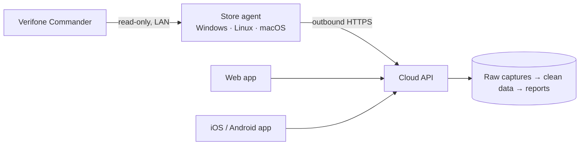

# C-Store-Flow

A cloud back office for independent gas stations on Verifone Commander (Ruby2 / Ruby Ci). Built first for Van Buren Food Express.

**Status: Phase 1.** The store agent reads the Commander (tested against a simulator), keeps a crash-safe queue, strips card data, and uploads raw captures to the API. The web and phone apps show the store connection only. See [docs/gaps.md](docs/gaps.md) for what is not real yet.



## Try it

```sh
npm install
npm run demo
```

`demo` starts a fake Commander with synthetic data, runs the agent once, and prints what reached the cloud.

## Run the parts

```sh
npm run simulator   # fake Commander, http://127.0.0.1:8180
npx tsx apps/api/scripts/new-agent-key.ts van-buren   # prints a key + AGENT_KEYS entry
AGENT_KEYS=van-buren:<hash> npm run api               # API on :8080
npm run web                                           # http://localhost:5173
```

Then copy `apps/agent/agent.config.example.json` to `apps/agent/agent.config.json`, point `commander.host` at the simulator (`http://127.0.0.1:8180`, user `AGENT`, password `sim`) and `apiUrl` at the API, set `CSF_AGENT_KEY`, and run `npm run agent`.

## Docs

| Doc | What's in it |
| --- | --- |
| [discovery.md](docs/discovery.md) | Decisions, store facts, open questions, competitor feature matrix, phase plan |
| [architecture.md](docs/architecture.md) | How the parts fit, data layers, repo layout |
| [commander-protocol.md](docs/commander-protocol.md) | What we know about the Commander, and how sure we are |
| [gaps.md](docs/gaps.md) | Everything stubbed or untested |
| [apps/agent/deploy](apps/agent/deploy/README.md) | Installing the agent as a service |
