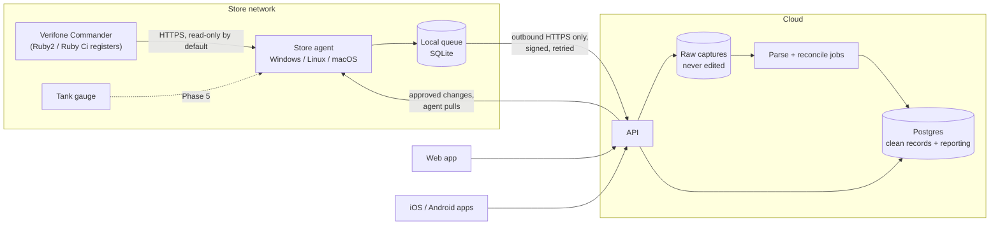

# Architecture

C-Store-Flow has four running parts. A **store agent** on a PC at the store, a cloud **API** with Postgres, a **web** app, and **iOS / Android** apps. All of it is TypeScript and shares one set of types.



The store agent only ever makes outbound connections. No port is opened at the store. Changes that go to the register (Phase 3 on) are pulled by the agent, never pushed in.

## Store agent (`apps/agent`)

One Node program, packaged per OS as a background service (Windows service, systemd unit, macOS launchd agent).

| Part | Job |
| --- | --- |
| Commander client (`packages/commander`) | Log in, make the calls in [commander-protocol.md](commander-protocol.md), always log out, back off on failure |
| Pollers | Every minute: list periods; capture any closed SHIFT or DAILY not yet captured; capture `current` Ruby summary for live sales |
| Redactor | Strip card data before anything is stored or sent |
| Queue | SQLite in the agent's data folder. Every capture is written here first, so a power cut or dead internet loses nothing |
| Uploader | Sends queued captures oldest first, with exponential backoff. Deletes a capture only after the API confirms it by hash |
| Heartbeat | Every minute: agent version, Commander reachable or not, queue depth, last capture. The cloud alerts when heartbeats stop |
| Change puller | Phase 3. Fetches approved price book changes, applies them, reads back to confirm, reports the result |

Rules:

- Read-only until writes are switched on in config **and** a change carries an approval id from the cloud.
- Never calls close-day or close-period.
- One Commander session at a time, released after each batch.
- Logs never contain passwords, cookies or card data.

## API (`apps/api`)

Fastify on Node. Routes in the scaffold:

| Route | Who calls it | Job |
| --- | --- | --- |
| `GET /health` | Monitoring | Up or down |
| `POST /v1/agent/heartbeat` | Agent | Record agent status |
| `POST /v1/agent/captures` | Agent | Store one raw capture; idempotent by SHA-256 |
| `GET /v1/stores/:storeId/status` | Web, phone | Agent last seen, queue depth, last capture |

Agents authenticate with a per-store key sent as a bearer token; the API stores only its hash. People will sign in with passwords plus a second step (Phase 2).

## Data layers

1. **Raw.** Every capture exactly as received (after card redaction), with hash, call and time. Never edited, never deleted.
2. **Clean.** Parsed records: periods, tickets, lines, tenders, fuel sales, tax buckets, Ruby report totals, PLUs. Rebuilt from raw at any time.
3. **Reporting.** Day and shift summaries, department mix, fuel by grade, cashier results. These feed the screens.

Every number on a screen keeps a link back to the raw capture it came from.

Money is stored as integer cents everywhere. Fuel volume is stored as integer thousandths of a gallon.

## Web and phone apps

- `apps/web`: React + Vite. Same screens as the phone with more room.
- `apps/mobile`: React Native with Expo, one codebase for iOS and Android, built and published with EAS. Camera barcode scanning, push alerts, Face ID or fingerprint sign-in, offline counts and receiving.
- Both talk only to the API, never to the store agent or the Commander.

## Repo layout

```txt
apps/
  agent/     store agent (Node, TypeScript)
  api/       cloud API (Fastify, TypeScript)
  web/       web app (React, Vite)
  mobile/    iOS and Android app (Expo)
packages/
  core/      shared types, money and time helpers
  commander/ Commander client, XML parsers, simulator, fixtures
docs/        discovery, architecture, Commander notes, gaps
```

## Testing

- Unit tests with Vitest in every package.
- A **Commander simulator** (`packages/commander/src/simulator.ts`) serves fixture XML over HTTPS-like routes so the agent runs end to end with no register.
- Fixtures under `fixtures/synthetic/` are built from MyStore's notes and are labelled as such. Real captures go under `fixtures/real/` and become the reconciliation tests in Phase 2.
